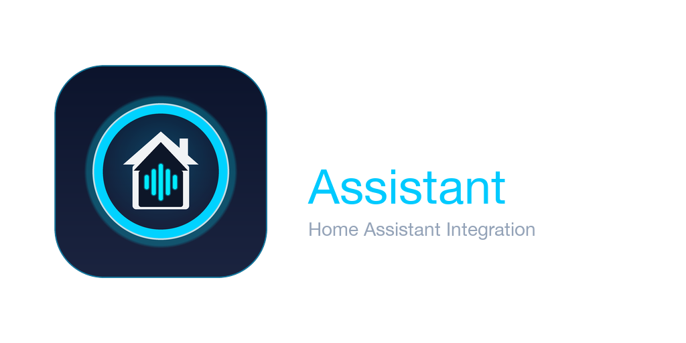
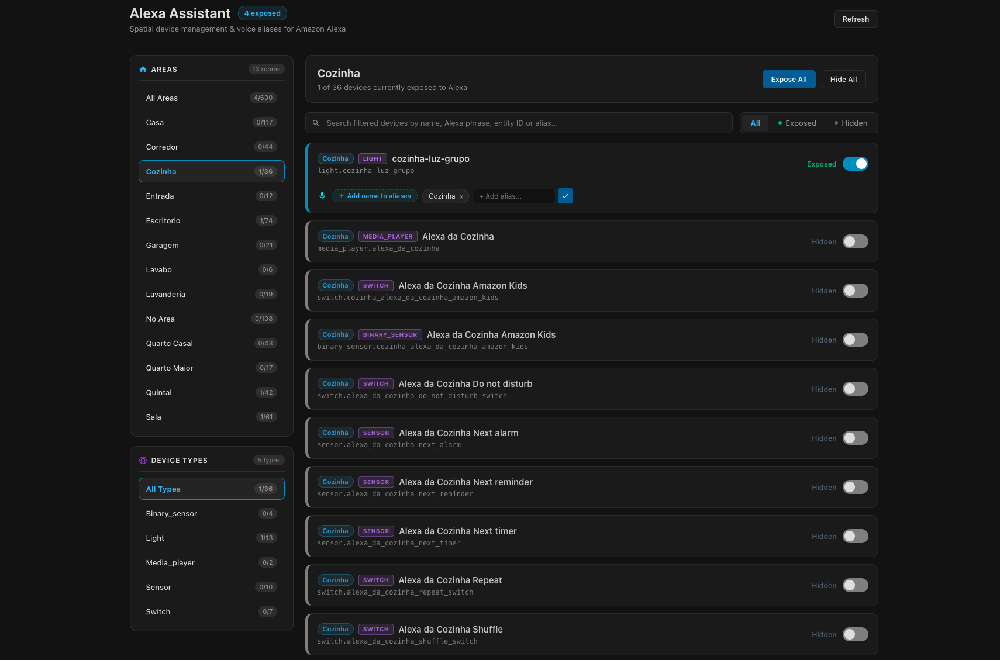

# Alexa Assistant

<p align="center">
  
</p>

<p align="center">
  <a href="https://hacs.xyz"></a>
  <a href="LICENSE"></a>
  <a href="https://github.com/alissonpdc/ha-alexa-assistant/releases"></a>
</p>

Manage Amazon Alexa entity exposure, voice integration, and custom skills directly in Home Assistant without a Nabu Casa subscription.

---

## The Problem

When using the official self-hosted/manual Alexa Smart Home integration (`alexa: smart_home:` via AWS Lambda), Home Assistant disables or ignores the built-in UI toggles under **Settings > Voice Assistants > Expose**, requiring users to maintain static entity filter lists in `configuration.yaml` and restart or reload every time.

## The Solution

**Alexa Assistant** connects the manual Alexa discovery pipeline to Home Assistant's core `exposed_entities` manager:

- **Dedicated Sidebar Panel**: Automatically adds an **Alexa** panel to the Home Assistant sidebar.
- **Strict Character Sanitization**: Automatically strips special characters from friendly names (only letters, numbers, and spaces) to guarantee 100% compliance with Amazon Alexa's naming requirements.
- **Up to 5 Voice Aliases**: Configure up to 5 custom voice aliases per entity, exposed directly to Alexa so you can control devices with multiple natural phrasing variations.
- **Visual Entity Management**: Search, filter by domain, and toggle which entities are exposed to Alexa with instant switches.
- **Bulk Actions**: Expose or hide filtered entities in one click.
- **Real-Time Synchronization**: Changes take effect immediately without restarting Home Assistant.
- **Zero YAML Filters Required**: No static lists in `configuration.yaml`.



---

## Setup Guide

For a complete step-by-step tutorial on creating your AWS Lambda, API Gateway proxy, and Amazon Alexa Smart Home Skill, see [docs/create-alexa-skill.md](docs/create-alexa-skill.md).

---

## Installation via HACS

1. Open **HACS** in your Home Assistant sidebar.
2. Click the three dots in the top right corner and choose **Custom repositories**.
3. Add repository:
   - **Repository**: `https://github.com/alissonpdc/ha-alexa-assistant`
   - **Type**: `Integration`
4. Click **Add** and search for **Alexa Assistant**.
5. Click **Download** and restart Home Assistant.

---

## Configuration

1. In Home Assistant, go to **Settings > Devices & Services**.
2. Click **Add Integration** and search for **Alexa Assistant**.
3. Confirm the setup.
4. Click on the **Alexa** item in the sidebar to open the visual manager.
5. In your `configuration.yaml`, ensure you have:
   ```yaml
   alexa:
     smart_home:
   ```

---

## License

This project is licensed under the MIT License - see the [LICENSE](LICENSE) file for details.
